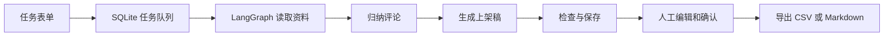

# Launch Studio · 跨境商品上新工作台

选择商品和目标站点，整理评论、商品事实和关键词，生成可以编辑、审核、导出的 Listing 草稿。

工作台包含上新任务、商品资料、技能与模板、历史与草稿四个页面。任务页左侧记录执行进度，右侧可以切换查看草稿、商品事实、评论依据和检查结果。

## 本机使用

安装 Python 3.11 至 3.13 和 [uv](https://docs.astral.sh/uv/getting-started/installation/)。在项目目录运行：

```powershell
uv sync --locked
uv run uvicorn studio.main:app --host 127.0.0.1 --port 8000
```

打开 [本机工作台](http://127.0.0.1:8000)，选择「三层桌面收纳架」和「Amazon 美国站」，点击**生成上架稿**。在「检查结果」里可看到样例中未填写的承重。在「上架草稿」里编辑、保存新版本、确认，再导出 CSV 或 Markdown。

默认可以使用两件内置商品，支持美国站英语和德国站德语样例。未连接模型时，新录入的商品会按已有资料生成填写模板，语言沿用录入内容。每件商品可以导入 UTF‑8 CSV 评论，表头为 `id,rating,text,source`，评分为 1–5，同商品的相同评论编号会更新。最多取 40 条评论用于单次任务，页面展示样本数和总数。

## 连接模型

复制 `.env.example` 为 `.env`，填入模型服务提供的 HTTPS 兼容地址、API 密钥和模型名，再重新启动。兼容地址应填写到 `/v1`，客户端会追加 `/chat/completions`。模型负责评论归纳和文案生成，每次会收到该任务选中的资料。接口或格式错误时，任务保存错误原因，可使用当时的资料快照重试。

```dotenv
LLM_BASE_URL=https://your-provider.example/v1
LLM_API_KEY=
LLM_MODEL=deepseek-v4.1-flash-1017
```

## 实现方式



- FastAPI 提供页面和接口，LangGraph 运行上新模板，SQLite 保存商品、评论、任务、事件和草稿版本。
- 提交任务后由后台处理。页面通过 SSE 接收已保存的进度，刷新或离开页面后可以继续查看。单进程模式下启动时会标记上次中断的任务。
- 每次提交保存商品快照。修改商品资料不会覆盖历史任务。保存草稿会生成新版本，新版本需要重新确认才能导出。
- 程序检查必填文案、项目建议长度、风险词和部分带单位的数字，供卖家复核。首版交付草稿文件，适用场景是本机单用户使用。启动时使用一个服务进程并绑定本机地址。

## 验证

```powershell
uv run pytest -q
uv run ruff check studio tests
```

浏览器演示路径是生成样例稿、核对评论和缺项、编辑标题、确认版本、下载、刷新后从历史重新进入。涉及模型的格式和引用校验使用模拟模型响应验证。
